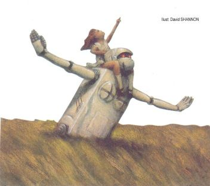

  

<h1 align="center">Robbie</h1>

  <strong>A new way to interact with your computer.</strong>

  An AI-powered desktop assistant exploring the intersection of artificial intelligence and human-computer interaction.

About

Inspired by Isaac Asimov's Robbie, this project explores the idea of a computer companion capable of understanding and interacting with its environment.

Robbie aims to bridge the gap between human intentions and computer operations, making desktop interaction more natural through artificial intelligence.
Vision

Computers should adapt to the way we think and work, not the other way around.

Robbie is an exploration of this idea — bringing AI closer to the desktop and rethinking how humans interact with their machines.
Development

🚧 Work in progress

Robbie is currently under active development. Its architecture and core capabilities are still being explored.

More to come.